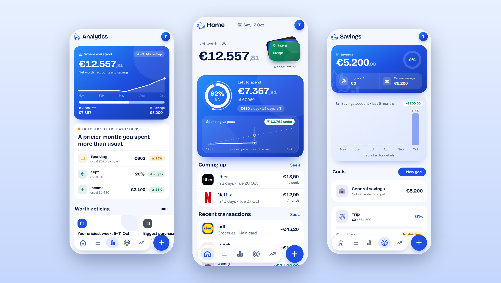
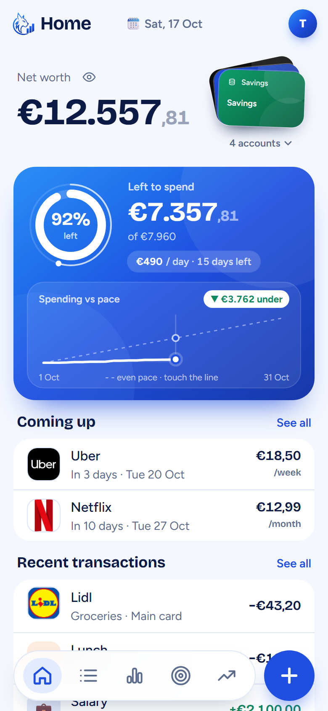
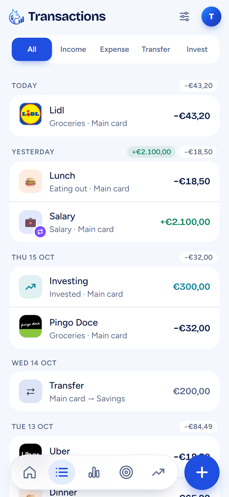
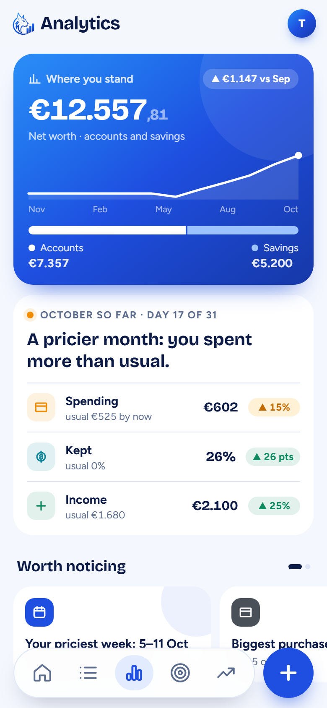
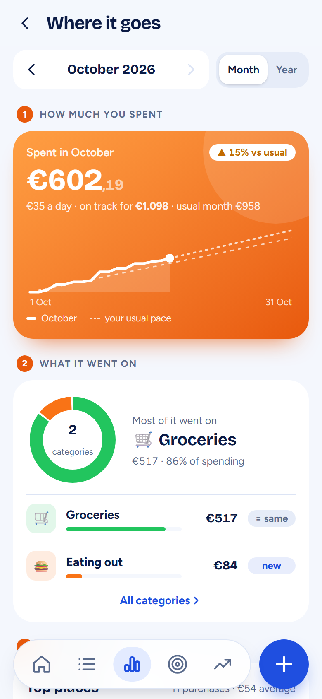
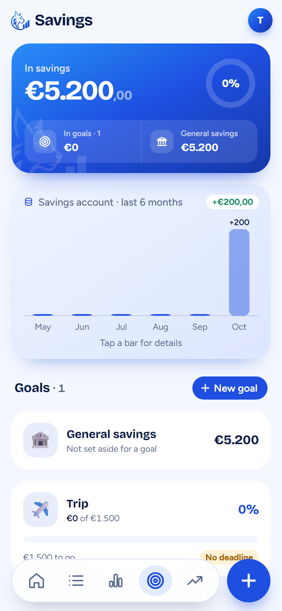
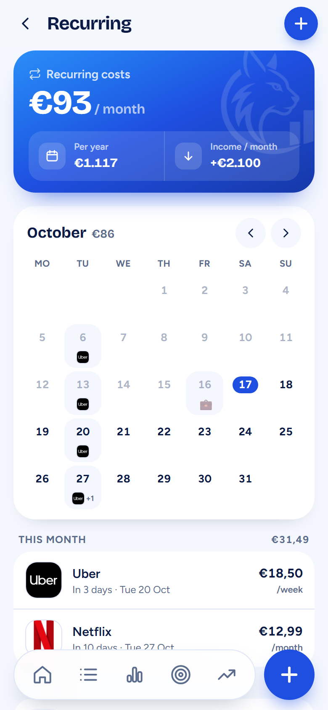
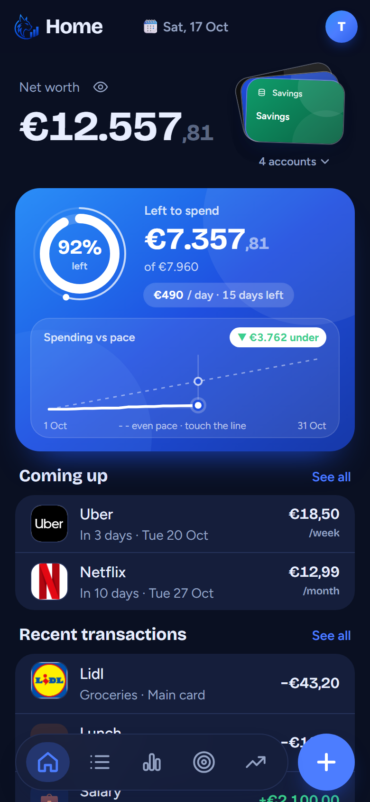

<div align="center">


# LynxOS

**A personal expense tracker for iPhone, installed from the browser.**

Every euro accounted for: accounts, budgets, savings goals, investments and analytics.<br />
Built as a home-screen web app for one person, with no app store, no ads and no tracking.

<br />


<br />



</div>

---

## Contents

- [Features](#features)
- [Screens](#screens)
- [How the money works](#how-the-money-works)
- [Tech stack](#tech-stack)
- [Project structure](#project-structure)
- [Getting started](#getting-started)
- [Scripts](#scripts)
- [Database](#database)
- [Testing](#testing)
- [Deployment](#deployment)
- [Security and privacy](#security-and-privacy)
- [Backups](#backups)

---

## Features

| Feature | What it does |
|---|---|
| ⚡ **Three-tap entry** | Amount → category → save. The number pad opens immediately, with the last-used account and today's date as defaults. |
| 💳 **Accounts as cards** | Bank, cash, savings and meal cards, shown as real-looking cards with bank logos. Balances are always calculated, never stored. |
| 🎯 **Budget to payday** | Your budget period starts on your payday. A ring shows what's left to spend, with a per-day amount and a spending-vs-pace line. |
| 🐷 **Savings goals that follow real money** | Every euro in savings belongs to a goal or to *General savings*, and goals always add up to the savings balance. |
| 📈 **Investments** | Reads your getquin portfolio (value, gain, positions). *Invest* and *Take out* transactions are tracked, never counted as spending. |
| 🔁 **Recurring payments and income** | Calendar view, "Coming up" on Home, one-tap *Paid* / *Received*, and phone reminders the morning before. |
| 📊 **Analytics around five questions** | Where do I stand? Where does my money go? Am I keeping enough? Better or worse? What should I notice? |
| 🔒 **App lock** | PIN and Face ID (passkey), locking every time the app is left. |
| 🌗 **Light, dark or auto** | Every screen is designed for both. |
| 📴 **Installable and offline-friendly** | Add to Home Screen. Full-screen, with its own icon, launch screen and an app shell that opens offline. |

## Screens

<table>
  <tr>
    <td align="center"><br /><sub><b>Home</b>: net worth, budget, coming up</sub></td>
    <td align="center"><br /><sub><b>Transactions</b>: by day, with filters</sub></td>
    <td align="center"><br /><sub><b>Analytics</b>: this month at a glance</sub></td>
  </tr>
  <tr>
    <td align="center"><br /><sub><b>Where it goes</b>: spending in depth</sub></td>
    <td align="center"><br /><sub><b>Savings</b>: goals and General savings</sub></td>
    <td align="center"><br /><sub><b>Recurring</b>: calendar of payments</sub></td>
  </tr>
  <tr>
    <td align="center"><br /><sub><b>Dark mode</b></sub></td>
    <td colspan="2"><sub>Screenshots use made-up demo data.</sub></td>
  </tr>
</table>

## How the money works

These rules are enforced in the app and covered by the [tests](#testing).

- **Integer cents everywhere.** Money is stored and calculated as whole cents, never floating-point, and shown European-style (`€1.234,56`). Amounts are capped at €9.999.999,99.
- **Balances are calculated, never stored.** Balance = starting balance + income − expenses − transfers out + transfers in − invested + taken out. The database adds it up (`account_balances()`).
- **No account below €0.** Every add, edit and delete is checked against today's balances, and so is every *Paid*. A change that doesn't lower an account is always allowed.
- **Transfers and investing are not spending.** They move money between your own pots and are left out of income and spending totals.
- **Goals follow the real money.** A goal's money = what its tagged transactions moved into savings + moves from other goals − moves out. Untagged money is *General savings*. No goal can go below €0.
- **Budget = money you can spend.** It's the balance of bank, cash and meal-card accounts (savings left out), plus what was already spent since payday.

## Tech stack

| Layer | Choice |
|---|---|
| UI | React 19, Tailwind CSS 4, hand-drawn SVG icons and charts (no chart library) |
| Build | Vite 8, `vite-plugin-pwa` (Workbox service worker, auto-update) |
| Data and auth | Supabase: Postgres with Row Level Security, email + password sign-in |
| Server | Vercel functions: getquin reader (`api/getquin.js`), daily reminders via Web Push (`api/remind.js`, Vercel Cron) |
| Tests | Vitest |
| Hosting | Vercel, deploying automatically from `main` |

## Project structure

```
├── api/                    Vercel functions (getquin reader, payment reminders)
├── docs/                   README images (brand, screenshots)
├── public/                 Icons, launch screens, logos, push service worker
├── scripts/backup.mjs      Monthly data backup (runs on the owner's PC)
├── src/
│   ├── components/         Shared UI: cards, sheets, number pad, icons, charts kit
│   ├── lib/                Logic: money, balances, goals, budget, analytics, filters…
│   ├── screens/            One file per screen (Home, Transactions, Analytics…)
│   └── App.jsx             Routing, app lock, screens loaded on demand
├── supabase/migrations/    Database changes, numbered and run in order
├── tests/                  Vitest tests for the money rules and the maths
└── vercel.json             Build command, cron schedule, function region
```

## Getting started

**Requirements:** Node.js 20+ and a Supabase project.

```bash
git clone https://github.com/blynce15/expense-tracker.git
cd expense-tracker
npm install
cp .env.example .env   # then fill in your Supabase URL and publishable key
npm run dev
```

Then run the files in `supabase/migrations/` in order in the Supabase SQL Editor. Create your account, and afterwards turn off public sign-ups in Supabase.

<details>
<summary><b>Environment variables</b></summary>

| Variable | Where | Purpose |
|---|---|---|
| `VITE_SUPABASE_URL` | app + server | Supabase project URL |
| `VITE_SUPABASE_PUBLISHABLE_KEY` | app + server | Public (publishable) key; Row Level Security protects the data |
| `VITE_VAPID_PUBLIC_KEY` | app + server | Web Push public key |
| `SUPABASE_SERVICE_ROLE_KEY` | server only | Reminders job (reads due payments) |
| `VAPID_PRIVATE_KEY` | server only | Signs push notifications |
| `CRON_SECRET` | server only | Only Vercel Cron may start the reminders job |

Server-only values are set in Vercel and never reach the app.
</details>

## Scripts

| Command | What it does |
|---|---|
| `npm run dev` | Start the app locally |
| `npm test` | Run the test suite |
| `npm run build` | Run the tests, then build for production (fails if a test fails) |
| `npm run lint` | Check the code with oxlint |
| `npm run backup` | Save a backup of all data (see [Backups](#backups)) |

## Database

Eight tables, each with `user_id` and Row Level Security (a user can only read and write their own rows):

`accounts` · `categories` · `transactions` · `savings_goals` · `goal_moves` · `recurring_payments` · `user_settings` · `push_subscriptions`

Database functions: `account_balances()` (balances), `record_recurring_payment()` (*Paid* in one step) and `delete_my_data()` (*Delete all data*). All three run as the signed-in user.

## Testing

```bash
npm test
```

71 tests cover the riskiest parts:

- **Money:** formatting, parsing typed amounts, the number pad
- **Balances:** the no-account-below-€0 rule for adds, edits, deletes, transfers and investing
- **Savings goals:** goals + General savings = savings balance; no goal below €0
- **Budget and recurring:** payday periods, next due dates (31st, short months, leap years)
- **Analytics:** totals, kept and rate, same-day comparisons, usual month, net worth, the year view

Tests never touch the database. Vercel runs them before every deploy, so a failing test stops a release.

## Deployment

Every push to `main` deploys to Vercel automatically: tests, then build, then publish. The app updates on the phone the next time it's opened.

## Security and privacy

- Row Level Security on every table; signed-out requests are refused.
- Only the publishable key is in the app. Secret keys live in Vercel's server settings.
- `.env` files are never committed.
- Public sign-ups are disabled; LynxOS has a single user.
- App lock with PIN and Face ID on the device.

## Backups

`scripts/backup.mjs` runs monthly on the owner's PC (Windows Task Scheduler) and saves every table to a dated folder: `backup.json` for restoring, plus one CSV per table. The database address lives in a local `.env.backup` file that is never committed.

---

<div align="center">
<sub>LynxOS · a personal project · built with Claude Code</sub>
</div>
